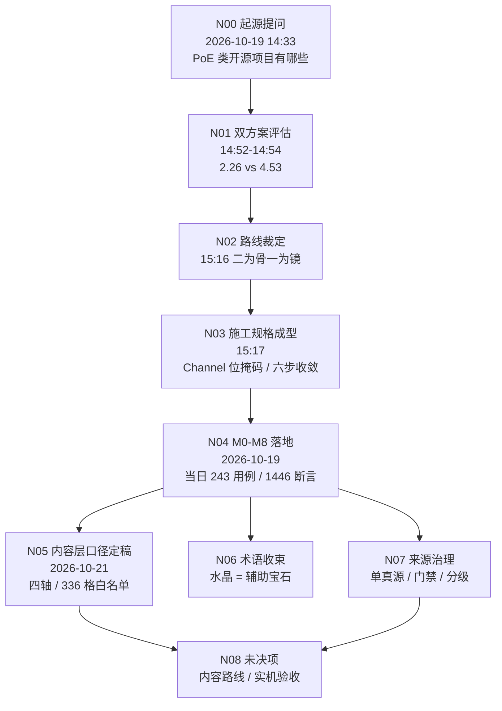

# 项目记忆图谱与证据链 v1

> **一句话**：本文件回答"这条规则从哪来、我能不能改、改了要谁同意"。
> 它是**索引**，不是新真源——与它指向的节点冲突时，**以节点为准**（台账 D-* / 施工规格 / 代码与测试）。

> **给执行 AI 的用法**：动手前先看 §六 的"修改准入五问"。答不出第 1 问，就停下申请，不要靠印象补。
> 本项目历史上最贵的两次错误，都不是写错代码，而是**在没有证据的地方自行发明规则**（D-16 记录）。

---

## 一、证据强度分级（比"文档级别"更本质）

| 级别 | 类型 | 例 | 能不能作为修改依据 |
|---|---|---|---|
| **E0** | 可运行事实 | 代码行、`@export` 字段、GUT 断言通过 | ✅ 最高，直接算 |
| **E1** | 版本历史 | `git log` / 提交 SHA / 某次 diff | ✅ 可查"什么时候、因为什么变的" |
| **E2** | 已裁定文本 | 台账 D-*、施工规格、`00/01/02` 总纲三件套 | ✅ 算，但要看它是否已被后续 D-* 替代 |
| **E3** | 会话原文 | `docs/证据_*.md` 里的逐字摘录 | ✅ 算"当时的原话"，不算"现在的规则" |
| **E4** | 记忆 / 印象 | AI 记忆文件、模型训练知识、他人转述 | ❌ **不得作为依据**，只能用来"提出疑问" |
| **EX** | 未投放的外部文件 | 项目外路径的一切 | ❌ 视为不存在（来源清单 R1） |

判断口诀：**能跑 > 有记录 > 有裁定 > 有原话 > 只是印象**。
低级别不能推翻高级别；高级别缺失时才允许用低级别**提出问题**，不允许直接改。

---

## 二、图谱总览



节点表：

| 节点 | 时间 | 类型 | 证据（可点） | 它确立了什麼 | 不可被"简化"的部分 |
|---|---|---|---|---|---|
| **N00** | 2026-10-19 14:33 | 人类提问 | `res://mods/jes-skills/docs/证据_起源会话_2026-10-19.md` §二 #0 | 问题起点：PoE 类技能系统的可复用开源方案 | — |
| **N01** | 2026-10-19 14:52–14:54 | 评估 | 同上 §3.1–3.2；产物"评审一页纸 / 评估书 v1.0"（在人类资料库，未入库） | 8 维五路评审：方案一 **2.26** / 方案二 **4.53**；否决方案一的四条客观证据 | 评分数字、四条证据的具体事实 |
| **N02** | 2026-10-19 15:16 | **人类裁定** | 同上 §二 #8 | 采用方案二："二为骨、一为镜"（PoB 语义 / kit 实现 / 方案一只读参考） | **路线本身不可改**，改需人类新裁定 |
| **N03** | 2026-10-19 15:17 | 规格成型 | 同上 §3.4–3.5；`res://mods/jes-skills/docs/施工规格_Godot技能系统_AI执行版_v1.0.md` §3.1 / §3.3 | ① `Channel{HIT,DOT,AILMENT}` 位掩码 + `tags` 正交 ② 六步装配 + 多轮收敛 + `conflicts_with` 回滚 ③ 黄金用例 G1–G10 | 这两条是**修 bug 后的形态**，不得退回"分系"或"线性跑一遍" |
| **N04** | 2026-10-19 | 框架落地 | `git log 12980af → fab87cc`；`res://mods/jes-skills/tests` | M0–M8 全部实现；**当日基线 243 用例 / 1446 断言**（现 261 / 1746）；D-01～D-13、P-01～P-23 均在此阶段产出 | 测试断言即事实（E0） |
| **N05** | 2026-10-21 | 内容口径定稿 | `git log 060f27e / e700056`；`res://mods/jes-skills/docs/设计方案_主动技能原稿/00_总纲_主动技能体系_v1.md` | 四轴（投送 6 × 形状 7 × 时序 4 × 辅助类别 2 = 336 格）、标签三类、白名单 ✅24 / ●106 / △56 / ×150 | 白名单**唯一展开处**是 `02`，别处不得再列 |
| **N06** | 2026-10-20 | 人类裁定 | 台账 **D-14** | 水晶 = 辅助宝石；行为名称（原"粒子"）、辅助类别（原"流派归属"） | 术语废止不可逆 |
| **N07** | 2026-10-20～21 | 治理 | 台账 **D-16 / D-18 / D-19 / D-20**；`res://mods/jes-skills/tests/docs/test_docs_provenance.gd` | 单真源、只读 `docs/`、禁项目外路径、递归门禁、S4 两类性质、证据链与引用存在性门禁 | 门禁只许加严，不许放宽 |
| **N08** | 进行中 | 未决 | 施工规格 §16「暂缓执行」；`res://mods/jes-skills/docs/开工提示词.md` 当前阶段块 | 内容生产路线 A/B/C 未裁定；Android / macOS / Linux 未实机 | **未决就是未决**，AI 不得自行选路 |

---

## 三、决策挂载点（D-01 ~ D-20）

> 每条都能落到一个节点上。找不到节点的决策 = 不该存在的决策。
> 新增 D-\* 必须同时在此追加一行，否则 `test_memory_graph.gd` 直接红（D-20 落地当天就被它抓过一次）。

| D | 一句话 | 节点 | 类型 |
|---|---|---|---|
| D-01 | 兼容性走 PoE2 前置拦截 + G7 fail-fast 兜底 | N03/N04 | 设计 |
| D-02 | 孔位上限 6，单一真源 `SOCKET_COUNT` | N04 | 实现 |
| D-03 | 投射物不按发建 Node，命中复用 1 个 Hitbox | N04 | 性能 |
| D-04 | 渲染数学抽纯函数 `instance_state()` | N04 | 可测性 |
| D-05 | 内容真源 = `content/gems/**/*.tres`，唯一入口 `GemRegistry` | N04 | 架构 |
| D-06 | RNG 契约 `next_float(stream)`，暴击只吃 `STREAM_DAMAGE` | N04 | 确定性 |
| D-07 | 装配缓存命中返回深拷贝 | N04 | 正确性 |
| D-08 | 冷却挂槽，不挂装配结果 | N04 | 心智模型 |
| D-09 | 条件门 fail-closed | N04 | 安全默认 |
| D-10 | `max_count` = 同时存在上限，满则顶最旧 | N04 | 语义 |
| D-11 | 演示 id 只许集中在一张编排表 | N04 | 纪律 |
| D-12 | `W1` = 第 1 批内容集，据此补第 8 个主动 | N04（**源头无定义**，见 §五） | 推断 |
| D-13 | Web(WASM) 非必需，保留两条纪律 | N04 | 范围 |
| D-14 | 水晶 = 辅助宝石；不得替换 `SkillData` 引用 | N06 | 术语 |
| D-15 | 条件门（第 4 口子）暂缓实现，开启清单固定 4 步 | N04/N08 | 范围 |
| D-16 | 来源治理：只读 `docs/`、禁外部路径、裁决顺序 | N07 | 治理 |
| D-17 | 等级曲线两段参数，不引入 `Curve` | N04 | 数据契约 |
| D-18 | 文档门禁递归 + 目录分级 | N07 | 治理 |
| D-19 | `99` = 给人看的合并本；`原始设计案` = 聊天历史过程稿 | N07 | 治理 |
| D-20 | 建立证据链：S6 图谱 + 冻结证据 + 引用存在性门禁 | N07 | 治理 |

---

## 四、反向追溯：改之前先定位（两个真实例子）

**例 1：想把"六步装配 + 收敛"改成"一遍线性装配"**

1. 先找承载点：`res://mods/jes-skills/systems/skills/socket_graph.gd` 的 `assemble()`。
2. 查图谱 → N03 → 打开 `docs/证据_起源会话_2026-10-19.md` §3.4：**源头已经踩过这个坑**（靠前的辅助会打开靠后的兼容性，线性跑一遍会错判）。
3. 结论：不是"简化"，是**回退到一个已知错误**。要改必须由人类出新裁定，并说明为什么原证据失效。
4. 改完必须同时改 `conflicts_with` 相关断言，并在台账追加 D-*。

**例 2：觉得"点燃也该吃 hit 词缀"，想让通道位掩码合并**

1. 承载点：`res://mods/jes-skills/systems/skills/skill_channel.gd`。
2. 查图谱 → N03（§3.4 的判定式）+ §3.5 的 G9：**通道隔离是手算验过的**，混了会让整体数值偏高 30%+。
3. 结论：这是数值事故，不是口味问题。**不许合并**。

---

## 五、悬空点（没有证据的地方，禁止填坑）

> 这一节存在的唯一目的：让后来者看到"这里没有答案"，而不是自己编一个。

| # | 悬空点 | 现状 | 允许的动作 |
|---|---|---|---|
| V-01 | `W1` 的定义 | 全项目无出处，D-12 只能按字面取严（= 首批 8 个主动） | 保持现状；人类若给定义，追加 D-* 取代 D-12 |
| V-02 | 内容生产路线（CFG / 自有 `.tres` / 适配层） | **仍未裁定**，§16 暂缓。2026-10-21 已把三条路的来源、优缺点、代码冲击整理成 `docs/内容生产路线_三选一分析_v1.md`（S6，**不选路**），并指出裁 A/C 需先投放 E-04 | 停；只做线路无关的缺陷修复。**整理选项 ≠ 可以选路**——仍须人类拍 Q1/Q2/Q3 |
| V-03 | 数值平衡基线 | 从未做过 | 可在沙盒跑数据，但**不得据此改数值**，先提方案 |
| V-04 | Android 真机 60fps | 本机无 SDK / 设备 | 外部阻塞，不算缺陷 |
| V-05 | macOS / Linux 实机 | 未跑过 | 同上 |
| V-06 | `godot-arpg-kit` 具体实现 | 只在 N01 被"抄/不抄"点名，代码未入库 | 不得声称"已按 kit 实现" |

---

## 六、修改准入五问（硬流程，不许跳）

改任何代码、数据、文档前，先回答：

1. **它属于哪个节点？**（N00–N08；一个都落不上 → 走第 5 步的申请）
2. **该节点的证据强度是 E0–E3 哪一级？**（E4 印象不算）
3. **改完会证伪原节点吗？** 会 → **停**，交人类裁定；不许自行判定"原证据过时"
4. **有测试能证明改对了吗？** 没有 → 先写测试（P-23：数量/语义断言必须同步改并写明依据）
5. **要不要追加 D-\*？** 要 → 在台账**表尾追加**，禁止改写既有行

配套红线：
- 不得以"看起来缺一块"为由新增口子（D-15 的教训）。
- 不得用"顺手统一"为由改术语（D-14 已定，改需新裁定）。
- 不得把未投放的外部文件当依据（R1）；需要时按《信息来源与真源清单》§七 申请。

---

## 七、维护规则（本文件自身怎么长大）

| 规则 | 说明 |
|---|---|
| 编号只增不改 | 新节点从 **N09** 起，按时间追加；已发布节点的编号、含义不得改 |
| 一节点一事件 | 不合并"顺便也做了"的事；合并会让后来者以为两件事同一个理由 |
| 引用用 `res://` 全路径 | 门禁 `test_memory_graph.gd` 会逐条检查**文件是否存在**，写错即红 |
| 引用写章节，不写行号 | 行号会漂移；章节名稳定 |
| 证据文件只读 | `docs/证据_*.md` 冻结；补新材料另开 `证据_*.md` 并记 D-* |
| 本文件与节点冲突 | **以节点为准**，并回来修正本文件（修正本身也要记 D-*） |

---

## 八、自检

```bash
# 1. 台账里每条 D-* 都要在本图谱出现（覆盖率）
grep -o 'D-[0-9][0-9]' mods/jes-skills/docs/踩坑与决策台账.md | sort -u
grep -o 'D-[0-9][0-9]' mods/jes-skills/docs/项目记忆图谱与证据链_v1.md | sort -u

# 2. 自动化门禁（含：图谱存在、D-* 全覆盖、所有 res:// 引用必须真实存在）
godot --headless --path . -s addons/gut/gut_cmdln.gd \
  -gtest=res://mods/jes-skills/tests/docs/test_memory_graph.gd -gexit
```

第 2 条已入库。它拦的是**编造依据**——引用一个不存在的文件，是这条链最常见的腐烂方式。

